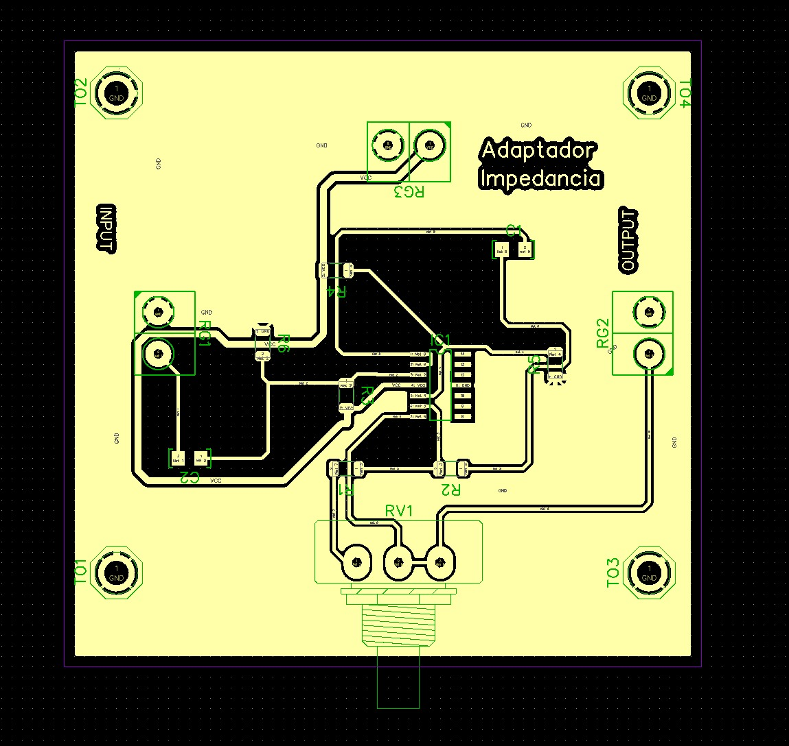

# Impedance Adapter PCB — Design & Construction

We designed and built an impedance-adapter PCB as a team project for **Diseño y Simulación Electrónica** at Universidad Politécnica de Cartagena.

We worked through schematic capture, component placement, track routing, board assembly and component soldering. We are sharing the editable DipTrace files alongside a PCB layout export.

*The image above shows the PCB layout, not a photograph of the manufactured board.*

## Project scope
We translated our circuit schematic into a PCB layout, arranging the components and connectors and routing the electrical connections. We then constructed and assembled the board during the course project.

The project connects analogue electronics with the practical steps required to produce a physical circuit board. We present it as an educational hardware project, without claiming measured performance or a validated application beyond the available documentation.

## Files
| File | Description |
|---|---|
| `design/impedance_adapter.dch` | Editable DipTrace schematic |
| `design/impedance_adapter.dip` | Editable DipTrace PCB layout |
| `exports/pcb_layout.pdf` | Original PCB PDF export |
| `images/pcb_layout.jpg` | Overview of the board layout |

## Opening the design
1. Open `design/impedance_adapter.dch` in **DipTrace Schematic Capture**.
2. Open `design/impedance_adapter.dip` in **DipTrace PCB Layout**.
3. Use the PDFs to inspect the available board views without installing DipTrace.

The native files have been copied without changing their contents. They have not been reopened or checked with DipTrace as part of repository preparation; the required software version and any library dependencies have not been verified.

## Engineering work
- We captured the electronic schematic and organised the component connections.
- We placed components and routed the PCB tracks.
- We prepared layout exports and constructed the physical board.
- We assembled and soldered the components as part of the course project.

## Documentation status
This repository contains the recovered schematic, board design and PDF exports. It does not currently include a bill of materials, Gerber manufacturing files, a photograph of the assembled board or measured test results. Those should be added only when the original files or records are available.

