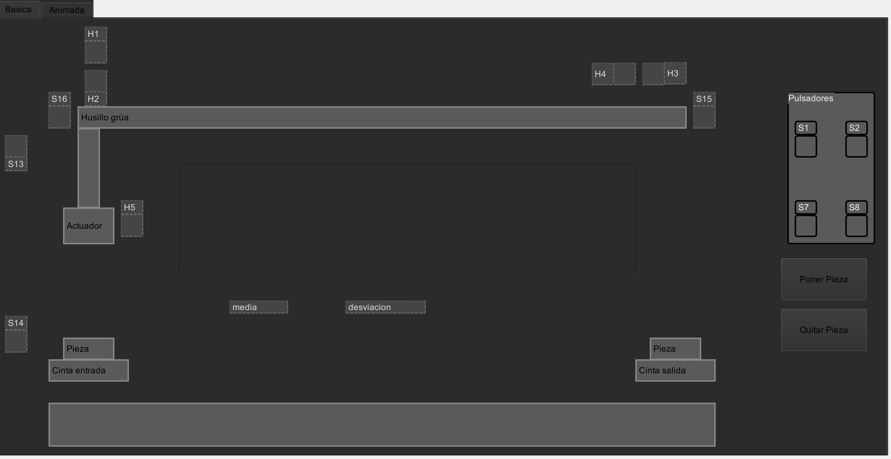
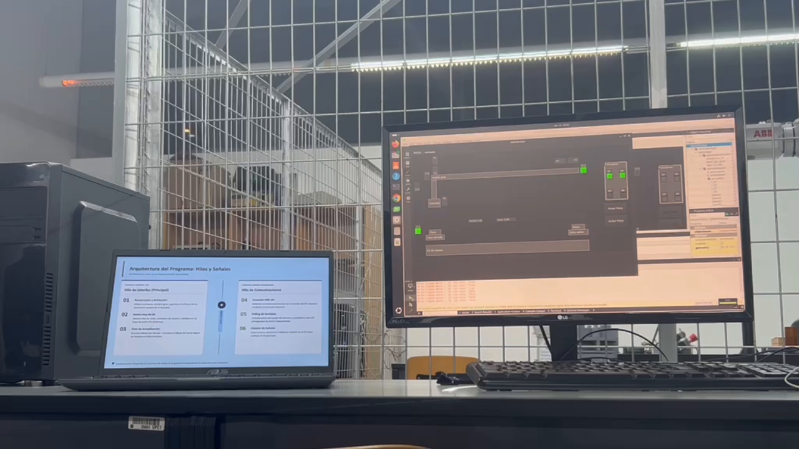
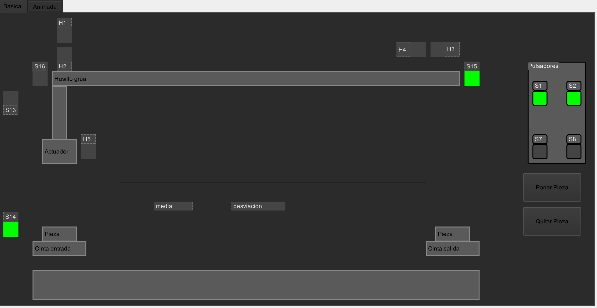

# Industrial Monitoring Interface with Qt, OPC UA & ROS2

We developed a C++/Qt human-machine interface to monitor and control a Lucas-Nülle laboratory crane station connected to a Siemens PLC. We combined industrial communication, animated equipment visualisation, data logging and ROS2 messaging in one application.



## What we built
- We displayed sensor and actuator states alongside a schematic representation of the station.
- We used a dedicated OPC UA worker thread to keep network communication separate from the graphical interface.
- We animated crane movement and provided controls for placing and removing a part.
- We recorded processed-box counts with timestamps, buffered records and wrote them to a text log.
- We displayed count statistics and added a spoken emergency-stop notification.
- We integrated a ROS2 Boolean topic with the Qt application.

## Architecture
We organised the application around three responsibilities:

1. **Qt interface:** we handled controls, indicator states, animations and timers in `mainwindow.cpp` and designed the layout in `mainwindow.ui`.
2. **OPC UA communication:** we implemented the worker in `worker.cpp`, using open62541 and Qt signals/slots to communicate with the interface.
3. **ROS2 integration:** we subscribed to `/mensajeS7` (`std_msgs/msg/Bool`) and serviced the ROS2 node through a Qt timer.

## Laboratory demonstration
We demonstrated the application with the laboratory equipment. The following still comes from our presentation video:



The image below shows a **reconstructed demonstration state** of our original Qt layout, with selected indicators enabled using the original application styles. It is not a capture of a live PLC connection:



## Technologies
C++17, Qt Widgets, Qt Creator, open62541 / OPC UA, ROS2 (`rclcpp`, `std_msgs`), CMake and Linux. We used ROS2 Humble in the original project environment. The voice notification uses `espeak`.

## Repository contents
| File or folder | Purpose |
|---|---|
| `main.cpp` | Application entry point |
| `mainwindow.cpp`, `mainwindow.h` | UI behaviour, animations, logging and ROS2 integration |
| `mainwindow.ui` | Original editable Qt Designer layout |
| `worker.cpp`, `worker.h` | OPC UA client and background communication |
| `definiciones.h` | Shared PLC state definitions |
| `recursos/` | Animation assets |
| `CMakeLists.txt` | Build configuration |
| `docs/technical_report_es.pdf` | Our original team report in Spanish |
| `images/` | Interface images and laboratory demonstration |

## Building and running
We developed this application for a configured Linux laboratory environment. To reproduce it, you need a C++17 compiler, CMake, Qt Widgets, open62541, ROS2 with `rclcpp` and `std_msgs`, and an OPC UA server with the expected node mapping.

Before building, source your ROS2 environment and make the Qt/open62541 CMake packages discoverable. For ROS2 Humble, a typical build sequence is:

```bash
source /opt/ros/humble/setup.bash
cmake -S . -B build
cmake --build build --parallel
```

Before launching, configure these original laboratory settings:
- In `MainWindow::onThreadStarted()`, replace the OPC UA endpoint with your server address. The supplied source retains our original private-network endpoint.
- In the constructor, replace the absolute path passed to `anima_icono()` with the location of `recursos/girar.gif` on your machine.
- Match the OPC UA namespace and node identifiers to your PLC configuration.
- Install `espeak` if you want the voice notification.

Run the built executable from the configured project directory:

```bash
./build/ejemplo_opc_cliente
```

## Scope and reproducibility
We are sharing the original source and report from our team project. The source has not been modified during portfolio packaging, and the complete Linux/PLC/ROS2 application has not been rebuilt or rerun as part of that packaging. The build commands above describe the expected setup rather than a newly verified installation. Interface images were rendered separately from the original `.ui` file; the reconstructed state is labelled explicitly.

This is an educational laboratory prototype. We do not present the emergency-stop display or voice notification as a certified safety function. Inspect the source and adapt it to your setup before using its write controls with laboratory equipment.

## Team and background
We completed this project for **Informática para la Automatización Industrial** at Universidad Politécnica de Cartagena in June 2026.

Our team: **Gala Navarro Alcázar, Jose Penalva Salmerón, Álvaro Martínez Muñoz and Marta del Pilar Marín López**. We present our work collectively; the report provides the original project documentation.
