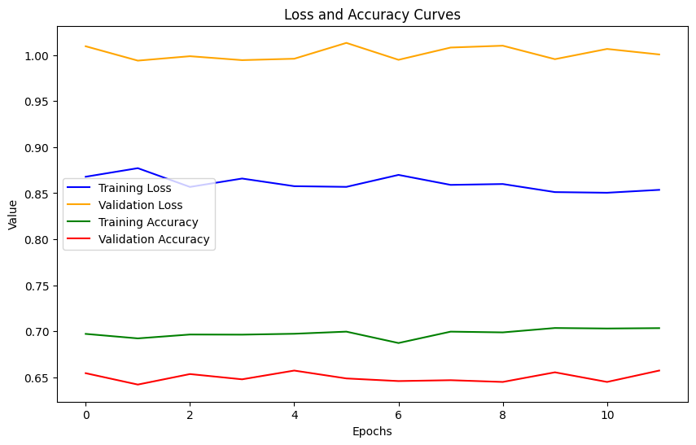
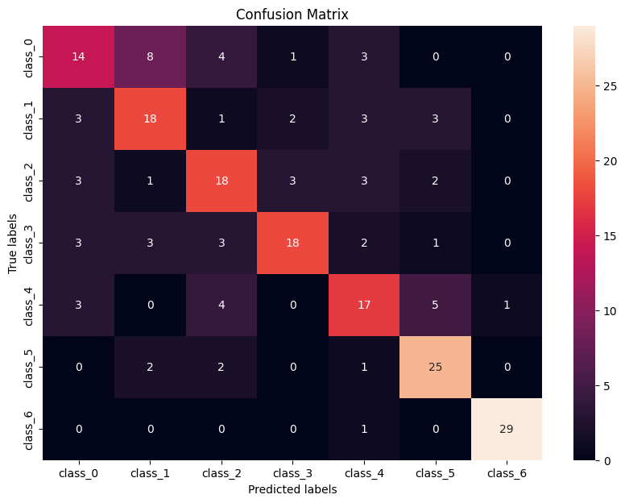
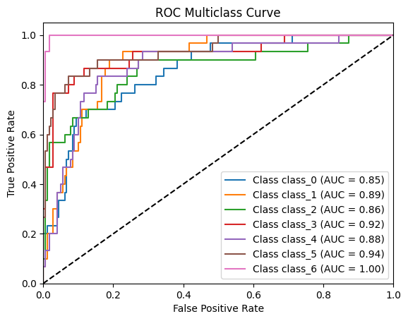

# Skin-Lesion Classification with PyTorch

Seven-class skin-lesion image classification using a convolutional neural network and transfer learning with a pretrained ResNet50. The project compares training behaviour and evaluates classification outputs using held-out test data within the supplied course dataset split.

## Approaches
- **CNN:** image preprocessing, data augmentation, training/validation monitoring and early stopping.
- **ResNet50 transfer learning:** pretrained weights, a frozen feature extractor and a replacement classification layer for seven classes.
- **Evaluation:** accuracy, precision, recall, F1-scores, confusion matrices and, in the ResNet50 notebook, per-class ROC curves.

## Notebooks
| Notebook | Contents |
|---|---|
| `notebooks/cnn_augmentation_evaluation.ipynb` | CNN workflow, augmentation and evaluation |
| `notebooks/resnet50_transfer_learning.ipynb` | Pretrained ResNet50, classifier training and evaluation |

## Saved evaluation figures
These are outputs embedded in the completed notebooks, not new training results.

## Dataset and execution
The image dataset, trained weights and checkpoints are not bundled. The original notebooks use a course-provided archive named `exp4val.zip`, with `train`, `val` and `test` directories and class subdirectories. This portfolio does not establish the original image source or patient-level independence of the splits.

1. Install the packages in `requirements.txt` in a suitable Python/PyTorch environment.
2. Obtain the original course dataset archive, or prepare a documented compatible seven-class dataset.
3. Open a notebook in Jupyter. Its setup creates a `datasets` directory under its working directory; place `exp4val.zip` there before running the extraction cell. After extraction, the images must be under `datasets/train/`, `datasets/val/` and `datasets/test/`.
4. Run the cells in sequence. GPU execution is recommended for training. Evaluation cells that load checkpoints require training to have produced the expected files; inspect and adapt checkpoint paths to your run.

If substituting a dataset, update class labels, normalisation and any dataset-specific assumptions rather than treating the stored outputs as applicable to the replacement data.

## Background
Individual coursework for Medical Image Processing at Universidad Politécnica de Cartagena. The notebooks include course instructions, supplied structures and completed analyses. The underlying ResNet architecture and teaching framework are not presented as original research.

## Portfolio preparation
The course-specific download URL was replaced with a local archive-loading cell and Google Drive mounting was removed. Model and analysis code was retained. The notebooks were checked for valid file structure but have **not been rerun or retrained** during packaging; embedded results are historical notebook outputs. Some original explanatory comments are in Spanish. These are educational experiments, not a clinically validated diagnostic system.
